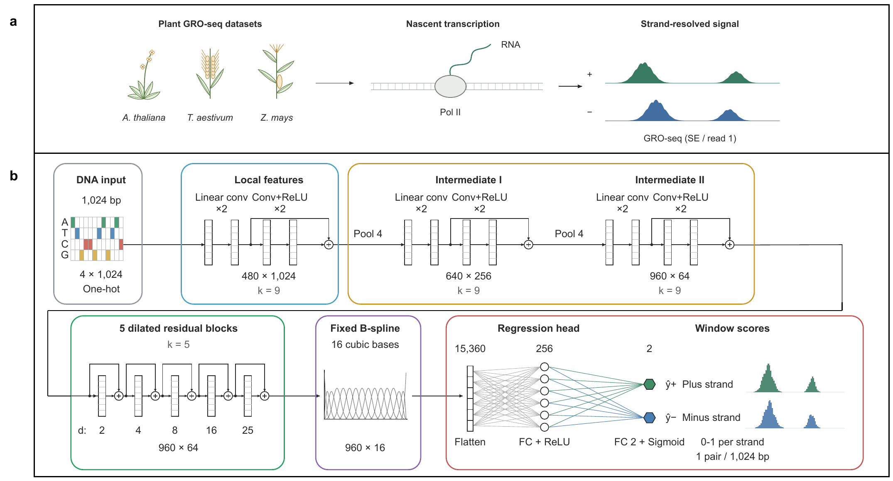

# GROPlant

**DNA sequence models for strand-resolved plant GRO-seq scores.**

GROPlant learns sequence features associated with reproducible GRO-seq intervals
in *Arabidopsis thaliana*, *Triticum aestivum* and *Zea mays*. Each independently
trained species model takes a **1,024-bp DNA sequence** and returns two continuous
**0–1 scores**, one for each reference-genome strand. This repository provides the
model implementation, trained weights, real DNA examples and the data and scripts
used to reproduce the research figures.

[Model guide](model/README.md) ·
[Download weights](https://github.com/wangyiduo217-beep/plant-pausing-bowtie2/releases/tag/strand-seiplant-v1-pretrained-20261112) ·
[Real DNA test set](model/examples/real_dna/README.md) ·
[Figures and plotting](figure/README.md)

[Selected final figures: PDFs, plotting code and exact data](figure/README.md#selected-final-figures)

## Schematic Diagram



**Figure 1a–b. GROPlant data workflow and model architecture.**
**(a)** GRO-seq datasets from Arabidopsis, wheat and maize capture nascent
transcription by RNA polymerase II and provide strand-resolved signals.
**(b)** A 1,024-bp one-hot DNA input passes through convolutional and residual
blocks, fixed B-spline pooling and a regression head to produce two raw 0–1
window scores, one per strand. Both panels are reproduced from the original
study figure. See the [model methods](model/docs/publication-model.md) and
[source and extraction details](figure/preview/figure1/groplant_framework.source.json).

## Key Features

- **Three species-specific models:** downloadable pretrained weights for
  Arabidopsis, wheat and maize, with fixed version identifiers and SHA-256 checksums.
- **Two strand scores from DNA:** forward-reference sequences produce separate
  plus/minus scores learned from experimental-consensus overlap targets.
- **A runnable real DNA test:** 72 sequences, genomic coordinates, reference
  assembly identities and archived predictions for checking a new installation.
- **Reproducible results:** Figures 1, 2, S1 and S2 with panel exports,
  complete held-out evaluation inputs and documented reproduction commands.
- **Documented training:** source code, selected configurations, sample accessions,
  chromosome splits and methods for preparing labels, training and genome scanning.

The selected model is **`strand_seiplant_v1`**, with repeat sequences retained and
**14 / 5 / 3 independent SRX libraries** for Arabidopsis / wheat / maize. Wheat
uses the original five-library model. GROPlant is the display name; the software
package version is **0.4.0**.

| Species | Independent SRX | Held-out test chromosomes | Test windows |
| --- | ---: | --- | ---: |
| *Arabidopsis thaliana* | 14 | 3 | 45,066 |
| *Triticum aestivum* | 5 | 3A, 3B, 3D | 98,656 |
| *Zea mays* | 3 | 6 | 49,786 |

The output scores summarize learned consensus-derived window targets. They are
not predicted CPM, calibrated probabilities or base-resolution measurements.
The three species are trained and evaluated separately.

<a id="start-from-a-fresh-download"></a>

## Quick Start

### 1. Download and install

Use **Code → Download ZIP** and extract the repository, or clone it:

```bash
git clone https://github.com/wangyiduo217-beep/plant-pausing-bowtie2.git
cd plant-pausing-bowtie2
```

Run all commands below from the repository root. Use **Python 3.10 or 3.11** and
create an independent environment:

```bash
python -m venv .venv
```

Activate it with `.venv\Scripts\Activate.ps1` in Windows PowerShell, or
`source .venv/bin/activate` on Linux/macOS. For Windows/Linux CPU prediction:

```bash
python -m pip install --upgrade pip setuptools wheel
python -m pip install torch==2.6.0 --index-url https://download.pytorch.org/whl/cpu
python -m pip install -r model/requirements-inference.txt -c reproducibility/requirements-acceptance-lock.txt
python -m pip install --no-deps -e .
```

This small prediction example needs no GPU, R, BAM files or full reference genome.
The CPU wheel command above targets Windows/Linux; see the
[installation guide](docs/acceptance.md) for platform details and the tested environment.

### 2. Download a model and test real DNA

Start with Arabidopsis:

```bash
python model/scripts/download_pretrained.py --species arabidopsis_thaliana
python model/scripts/check_pretrained_example.py --species arabidopsis_thaliana
```

Each checkpoint is approximately **310 MB**. Downloads are verified against the
file size and SHA-256 recorded in
[`model/metadata/pretrained_models.json`](model/metadata/pretrained_models.json),
then stored in `model/results/strand_seiplant_v1/<species>/model/best.pt`.

The check runs the network on **24 real 1,024-bp DNA sequences** and compares all
**48 strand scores** with the archived expected predictions. A successful run
exits with code 0 and reports `passed: true`, `sequences: 24` and
`strand_scores: 48` in its comparison result. Predictions and comparison JSON
files are saved under `model/results/pretrained_example/`.

To download and check all three species (**72 sequences / 144 strand scores**),
use `--force` to replace any outputs from the earlier small-example check:

```bash
python model/scripts/download_pretrained.py --species all
python model/scripts/check_pretrained_example.py --species all --force
```

If an earlier check already created its output files, add `--force` to the check
command or choose a new `--output-dir`. Every score must satisfy
`abs(actual - expected) <= 0.0002 + 0.001 * abs(expected)`.

The [real DNA test package](model/examples/real_dna/README.md) contains the FASTA
inputs, expected predictions, genomic coordinates and reference assembly
versions. These selected examples test software functionality; use the complete
held-out datasets for performance evaluation. More options are in the
[pretrained-model guide](model/docs/pretrained-quickstart.md).

### 3. Predict your own DNA sequences

Run this example, then replace the `--fasta` path with your own file:

```bash
python model/scripts/predict_fasta.py --species arabidopsis_thaliana --fasta model/examples/real_dna/arabidopsis_thaliana.fa --output model/results/custom_predictions.tsv
```

Each FASTA record must have a unique identifier and exactly **1,024 A/C/G/T
bases**. Use the forward-reference orientation to interpret the two outputs as
genomic plus/minus strands. The output columns are `sequence_id`,
`prediction_plus` and `prediction_minus`. Other supported species identifiers
are `triticum_aestivum` and `zea_mays`; use the matching checkpoint for each species.
For scanning a full reference genome, follow the
[genome-prediction instructions](model/docs/publication-model.md).

## Training

The [selected model and training guide](model/docs/publication-model.md) describes
reference preparation, label construction, chromosome splits, training and
genome prediction. Reference FASTA/FAI files and original experimental inputs
must be obtained separately; their identities and sample accessions are recorded
in the repository.

| Content | Location |
| --- | --- |
| Network implementation, preparation, training and genome scanning | [`model/src/plant_pausing_bowtie2/strand_model.py`](model/src/plant_pausing_bowtie2/strand_model.py) |
| Selected model parameters and chromosome splits | [`model/configs/publication_v1_model.json`](model/configs/publication_v1_model.json) |
| Selected label-generation configuration | [`model/configs/publication_v1_labels.json`](model/configs/publication_v1_labels.json) |
| Training and prediction entry points | [`model/scripts/`](model/scripts/) |
| Sample accessions, source identities and checkpoint records | [`model/metadata/`](model/metadata/) |

The guide distinguishes retraining from reconstruction of the frozen results.
The earlier alignment, trimming and interval-calling workflows are described in
the [processing guide](model/docs/legacy-pipeline-guide.md) and
[label-generation methods](model/docs/groseq-y-label-generation.md).

## Plotting Code

**Find a figure, then open its folder under `figure/plotting/`.** Each folder's
README gives the installation command, drawing command, data definitions and
individual-panel mapping. `figure/scripts/` contains data checks only.

| Figure | Content | Drawing scripts and commands | Plot data |
|---|---|---|---|
| **Figure 1** | Workflow, model and evaluation, a–n | [figure1/](figure/plotting/figure1/README.md) | [figure1](figure/data/figure1/) |
| **Figure 2** | Cross-species radar + tracks, a–f | [figure2/](figure/plotting/figure2/README.md) | [figure2](figure/data/figure2/) |
| **Figure S1** | Regional correlation and mean signal, a–f | [figureS1/](figure/plotting/figureS1/README.md) | [summary](figure/data/figureS1/) + [shared windows](figure/data/regional/) |
| **Figure S2** | CPM deciles with grouped strands, a–c | [figureS2/](figure/plotting/figureS2/README.md) | [figureS2](figure/data/figureS2/) |

The [figure gallery](figure/preview/README.md) displays the complete selected
figures inline and links their original PDFs. The
[script index](figure/plotting/README.md#selected-final-figures-script-index)
lists the exact entry filenames and run commands. Plot-only reproduction needs
no GPU, model weights or raw sequencing files. Workflow/model schematic panels
use the preserved author-supplied vector artwork; see the combined figure guide
for that source boundary.

### Redraw the final figures

Use a separate Python 3.12 plotting environment and the dependencies specified
in the [plotting guide](figure/plotting/README.md#environment). Figure 2 also
requires R 4.2.1 or later with Cairo. Install Arial locally; font binaries are
not redistributed. From the repository root:

```bash
python figure/plotting/reproduce_all.py --font-dir "C:/Windows/Fonts"
```

Use the directory containing your Arial fonts on other systems, and supply
`--rscript` if needed. The command generates the four final layouts and their
individual panels under **`figure/results/`**. It uses the supplied inputs
without model inference or weight downloads. The original PDF filenames are
preserved; the containing directory identifies the manuscript figure number.

The [figure methods](figure/docs/publication-figures.md) define all quantities:
positive CPM windows are grouped into deciles independently by species and
strand, with zeros reported separately. Decile intervals use supplied
frozen bootstrap results. HiLearn's native trapezoidal PR AUC and separately
saved exact average precision (AP) are distinct metrics.

## Repository Structure

```text
model/
  src/                     Model and processing implementation
  configs/                 Training, label and reference parameters
  scripts/                 Download, prepare, train and predict
  metadata/                Weight URLs, checksums and sample identities
  examples/real_dna/        DNA inputs, coordinates and expected predictions
  tests/                   Automated software tests
  docs/                    Model methods and usage guides
figure/
  data/                    Frozen evaluation and plotting inputs
  plotting/                All drawing entry points, settings and panel mappings
  scripts/                 Input-verification tools only
  preview/                 Complete final figures, original PDFs and supporting previews
  docs/                    Figure definitions and statistical methods
check_installation.py       Complete installation and reproduction check
reproducibility/            Dependency lock, file hashes and acceptance outputs
docs/                      Shared acceptance, licensing and attribution guides
LICENSE, LICENSES/         Code, weights/data and third-party licenses
```

Start with **[model/README.md](model/README.md)** to use the models, or
**[figure/README.md](figure/README.md)** to browse and reproduce the figures.
Downloaded weights and generated predictions are created under `model/results/`;
regenerated figures are created under `figure/results/`. These local output
folders are excluded from version control.

## Reproducibility

After installing the model validation dependencies in the
[installation guide](docs/acceptance.md), run:

```bash
python check_installation.py --require-isolated-env
```

The default checks dependencies and software tests, verifies input identities
and all 193,508 test windows, checks decile data, downloads or verifies the three
weights, and runs the 72 real DNA examples. A first run downloads approximately
**930 MB** of weights.

Figure drawing is optional: add `--figures --figure-python /path/to/plotting/python`
and `--font-dir /path/to/Arial/fonts` to also regenerate Figures 1, 2, S1 and S2.
The separate plotting interpreter avoids mixing the model validation lock with
the final-figure dependencies. To draw figures only, use the plotting command
above.

Successful completion prints:

```text
PASS: model and input checks completed; 72 real DNA sequences / 144 strand scores checked.
```

The command exits with code 0, and `reproducibility/acceptance/summary.json`
records `"passed": true` with every step passed. The
[acceptance guide](docs/acceptance.md) explains output files, platform/font
limits and the validation record. The
[v0.4.0 release](https://github.com/wangyiduo217-beep/plant-pausing-bowtie2/releases/tag/groplant-v0.4.0-20261112)
identifies the tested source version; later homepage changes do not imply a new
model validation. This check covers distributed inference and figure reproduction;
full retraining and raw-read processing require the separate inputs above.

## Citation and Attribution

Please cite the archived software version you use and acknowledge **GROPlant
contributors**. Software citation information is provided in
[`CITATION.cff`](CITATION.cff). No GROPlant manuscript DOI is currently provided.

The sequence architecture was developed with reference to
[SeiPlant](https://github.com/compbioNJU/SeiPlant), associated with Lv *et al.*,
*Cross-species prediction of histone modifications in plants via deep learning*,
Genome Biology (2026), [doi:10.1186/s13059-025-03929-4](https://doi.org/10.1186/s13059-025-03929-4).
GROPlant adapts the architecture to GRO-seq consensus targets and supplies its
own trained weights. See [methodological and third-party attribution](docs/reference-and-attribution.md).

## License and Support

Original code and documentation use the **[MIT License](LICENSE)**. GROPlant
pretrained weights and original generated figures/data use
**[CC BY 4.0](LICENSES/CC-BY-4.0.txt)**, with attribution to **GROPlant contributors**.
Reference DNA, upstream code, experimental sources and dependencies retain their
original terms; see the [license scope](docs/licensing.md).

For usage questions or reproducibility problems, open a
[GitHub issue](https://github.com/wangyiduo217-beep/plant-pausing-bowtie2/issues)
with the repository version, operating system, command and relevant error output.
