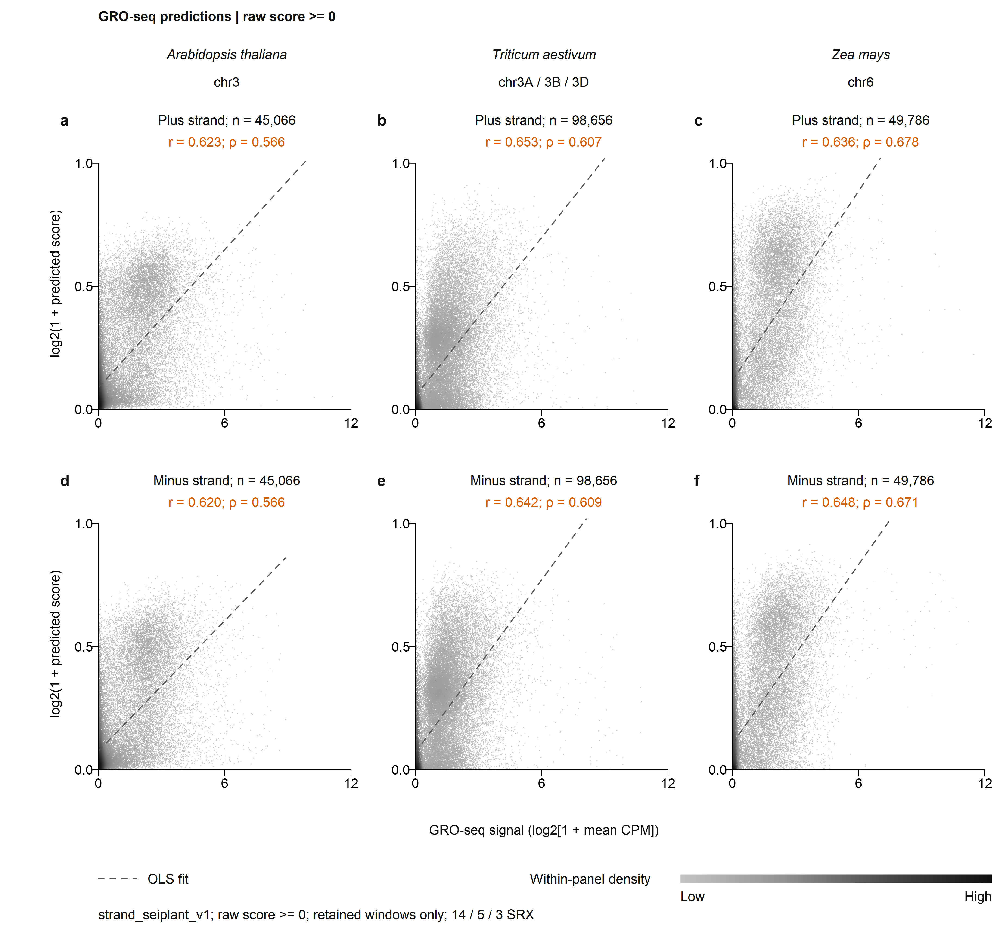

# GROPlant

DNA sequence models for plant GRO-seq scores and reproducible research figures.

The repository has two main folders: **[model/](model/README.md)** for model
code, configurations, pretrained inference and real DNA tests, and
**[figure/](figure/README.md)** for results data, plotting scripts and previews.
Run the installation and command examples below from the repository root.

**Selected analysis: `strand_seiplant_v1`, repeat sequences retained, Arabidopsis / wheat / maize = 14 / 5 / 3 SRX.** Wheat uses the original **five-library** model. Package version **0.4.0** reorganizes files and updates their paths; model parameters, checkpoint bytes and scientific results are unchanged. GROPlant is the display name; the frozen model identity remains `strand_seiplant_v1`.

| Species | Independent SRX | Held-out test chromosomes | Test windows |
|---|---:|---|---:|
| *Arabidopsis thaliana* | 14 | 3 | 45,066 |
| *Triticum aestivum* | **5** | 3A, 3B, 3D | 98,656 |
| *Zea mays* | 3 | 6 | 49,786 |

Each species is trained independently. One **1,024-bp DNA sequence** produces two **continuous 0-1 scores**, one for each genomic strand. The scores summarize experimental-consensus overlap; they are not predicted CPM, calibrated probabilities, or base-resolution measurements.



Additional [ROC/PR and paired-violin previews](figure/preview/README.md) are generated by the supplied scripts.

## Repository contents

```text
model/
  src/                        Alignment, labels and model implementation
  configs/                    Model and processing parameters
  scripts/                    Download, prepare, train and predict
  metadata/                   Model identity, weight URLs/hashes and samples
  examples/real_dna/          72 DNA inputs, coordinates and expected predictions
  data/masks/                 Selected exclusion masks
  tests/                      Automated model and workflow tests
  docs/                       Model methods and prediction/training guides
  results/                    Downloaded weights and model outputs (created locally)
figure/
  data/                       Frozen plotting data and statistical results
  plotting/                   Six R figure families and editable settings
  scripts/                    Python ROC/PR, other plots and input checks
  preview/                    Ready-to-view figure images
  docs/                       Figure definitions and statistical conventions
  results/                    Regenerated figures and tables (created locally)
check_installation.py          Combined installation and reproduction check
reproducibility/               Dependency lock, file hashes and acceptance outputs
docs/                         Shared acceptance, licensing and attribution guides
pyproject.toml                Install the Python package from this root
LICENSE, LICENSES/            MIT, CC BY 4.0 and upstream notices
```

Start with [model/README.md](model/README.md) to use the model, or
[figure/README.md](figure/README.md) to browse and redraw the results. Large
checkpoints remain release downloads; the downloader stores them under
`model/results/`. Shared installation and licensing files stay at the root.

## Start from a fresh download

Download this repository using **Code → Download ZIP**, extract it, and open a
terminal in the extracted folder. Alternatively:

```bash
git clone https://github.com/wangyiduo217-beep/plant-pausing-bowtie2.git
cd plant-pausing-bowtie2
```

Use Python 3.10 or 3.11. Create a new environment without inherited packages:

```bash
python -m venv .venv
```

Activate it with `.venv\Scripts\Activate.ps1` in Windows PowerShell, or
`source .venv/bin/activate` on Linux/macOS. Then install:

```bash
python -m pip install --upgrade pip setuptools wheel
python -m pip install torch==2.6.0 --index-url https://download.pytorch.org/whl/cpu
python -m pip install -r model/requirements-inference.txt -r figure/requirements.txt -c reproducibility/requirements-acceptance-lock.txt
python -m pip install --no-deps -e .
```

The PyTorch CPU command above targets Windows/Linux. Install R 4.2.1 or later
with Cairo support for the R plots; no extra CRAN packages are needed. Use
Arial for the requested publication typography, or an installed DejaVu Sans
or Liberation Sans fallback. See the [complete acceptance guide](docs/acceptance.md) for
platform details, output locations and the tested environment.

## Verify the installation and results

From the repository root:

```bash
python check_installation.py --font "DejaVu Sans" --require-isolated-env
```

This checks the software and input files, downloads/verifies all three
checkpoints, predicts all 72 bundled real DNA sequences, validates decile and
frequency inputs, and generates six R figure families plus the Python ROC/PR
figure. If `Rscript` is not on PATH, add `--rscript "FULL/PATH/TO/Rscript"`.
The three weights total about 930 MB; already verified files are reused.
The downloader uses small HTTP ranges with bounded retries to tolerate
interrupted connections, and checks the complete size and SHA-256 before use.

Successful individual checks report:

| Check | Expected result |
| --- | --- |
| `python -m unittest discover -s model/tests -v` | Ends with `OK`; Windows skips the two Linux execution-guard tests |
| `python figure/scripts/verify_publication_inputs.py` | Reports `193,508 complete windows` verified |
| `python model/scripts/check_pretrained_example.py --species all` | Each species reports `passed: true`, 24 sequences and 48 strand scores |
| R plotting entry point | Completes all six figure families and writes PDFs/PNGs under `figure/results/` |
| Full acceptance entry point | Exits with code 0 and writes a summary with every step passed |

For the example score comparisons, all 144 scores must satisfy
`abs(actual - expected) <= 0.0002 + 0.001 * abs(expected)`. Archived expected
predictions are not rewritten to make the check pass. These selected sequences
check functionality; they are not a new performance benchmark.

The acceptance scope is the distributed inference and figure-reproduction
workflows. Full retraining and processing the original FASTQ/BAM collections
require separately obtained data and are described below.

## Try the trained model on real DNA

Pretrained checkpoints for all three species are available from the
[model download release](https://github.com/wangyiduo217-beep/plant-pausing-bowtie2/releases/tag/strand-seiplant-v1-pretrained-20261112). Each is approximately 310 MB.
The repository includes **24 real held-out DNA windows per species**, their
coordinates and archived expected predictions. The check actually runs the
network; it does not read precomputed predictions as its output.

Follow the [CPU installation and quick start](model/docs/pretrained-quickstart.md), then:

```bash
python model/scripts/download_pretrained.py --species arabidopsis_thaliana
python model/scripts/check_pretrained_example.py --species arabidopsis_thaliana
```

Use `--species all` to check all three species. To predict your own 1,024-bp
FASTA sequences, use `model/scripts/predict_fasta.py` as explained in the guide.

## Reproduce the current figures

The **complete plotting inputs are included**. Plot-only reproduction does not need FASTQ, BAM, a genome FASTA, a GPU, or trained checkpoints. All 193,508 held-out test windows are retained; no low-prediction threshold is applied to the primary correlation plots.

### Six R figure families

Install R with Cairo graphics support. In R, from the repository root:

```r
source("figure/plotting/run_all.R", encoding = "UTF-8")
```

These scripts use standard R. They can also be sourced by absolute path from another working directory. Settings and individual entry points are documented in [the plotting guide](figure/plotting/README.md). Outputs go to `figure/results/` and are excluded from version control.

Current conventions:

- **Correlations:** same-strand, same 1,024-bp test windows; x = `log2(1 + mean SRX CPM)`, y = `log2(1 + predicted score)`. Each SRX is normalized independently before averaging. Axes start at zero; the line is ordinary least squares. Filtering is an optional exploratory setting, with default threshold **0**.
- **Tracks:** raw 0-1 window scores, 1,024-bp inputs and 128-bp sliding step. Scores are displayed on the central 128 bp. Experimental endpoint-CPM tracks and predictions have different units. Selected loci illustrate agreement and are not the whole-test evaluation.
- **Regional correlations:** the original eight region assignments and test windows, with strands kept separate. The assignment uses the window midpoint and the canonical protein-coding transcript reference.
- **CPM deciles:** zero CPM is listed separately; positive windows are ranked into ten equally sized groups independently for each species and strand. The default puts both strands beside each other in each species panel. Points and 100-kb block-bootstrap intervals use the frozen supplied statistics; rerendering does not rerun bootstrap.
- **Signal frequency:** all formal windows, including zeros; fixed-width 0.25 bins of `log2(1 + mean CPM)` and percentages of the full panel population. A logarithmic-y detail view is also provided.
- **Violin plots:** paired experiment/prediction distributions. Green uses the left `log2(1 + mean CPM)` axis (0-4); orange uses the right `log2(1 + score)` axis (0-1). Densities use **all** windows; the experimental viewport alone is zoomed. Arrows report the fraction above its limit. No min-max normalization is applied.

Arial is requested at 7 pt, with 8-pt panel letters. Install a properly licensed font locally; font binaries are not included. A substituted font can change layout and should be checked before submission.

### ROC and PR curves with HiLearn

```bash
python -m pip install -r figure/requirements.txt
python figure/scripts/plot_publication_roc_pr.py
```

This calls the **unmodified HiLearn 0.2.2** curve functions with seed 42, using complete test records and same-strand consensus-intersection truth. Both strands are pooled in matching order. HiLearn samples score thresholds, not test windows. Its native **PR AUC is trapezoidal and is not average precision (AP)**; exact full-threshold AUROC/AP are saved separately. See [figure definitions](figure/docs/publication-figures.md).

## Build labels and train the selected model

Training requires reference FASTA/FAI files and the original experimental inputs, which are not included as large biological files. The selected sample list, chromosome splits, checkpoint hashes, and input identity records are in [the model guide](model/docs/publication-model.md) and `model/metadata/`.

```bash
conda env create -f model/environment.yml
conda activate plant-pausing-bowtie2
python -m pip install --no-deps -e .

# Edit the reference/BAM paths in a copy of the selected configurations.
plant-groseq-y plan model/configs/publication_v1_labels.json
python model/scripts/run_groseq_y.py model/configs/publication_v1_labels.json

conda env create -f model/environment-model.yml
conda activate plant-pausing-model
python -m pip install --no-deps -e .

plant-pausing-model plan model/configs/publication_v1_model.json
# Prepare all three species together: species ordering affects background seeds.
python model/scripts/prepare_model_data.py model/configs/publication_v1_model.json
python model/scripts/train_strand_model.py model/configs/publication_v1_model.json \
  --species triticum_aestivum --device cuda:0
python model/scripts/predict_genome.py model/configs/publication_v1_model.json \
  --species triticum_aestivum --device cuda:0
```

The model guide distinguishes retraining from exact reconstruction of the frozen results. Pretrained weights are available as [release assets](https://github.com/wangyiduo217-beep/plant-pausing-bowtie2/releases/tag/strand-seiplant-v1-pretrained-20261112), with download and source hashes recorded in `model/metadata/pretrained_models.json`. The complete figure inputs also support evaluation/plot reproduction without downloading weights.

## Earlier processing workflow

The alignment, trimming, HOMER interval calling, and label code remain available. See the [original processing guide](model/docs/legacy-pipeline-guide.md), [alignment methods](model/docs/methods.md), and [label-generation methods](model/docs/groseq-y-label-generation.md). Earlier `plot_bam_vs_prediction.py` commands use an older coverage definition; use `figure/plotting/` for the current endpoint-CPM figures.

## Validation

```bash
python -m unittest discover -s model/tests -v
python figure/scripts/verify_publication_inputs.py
```

Model/preparation tests do not replace biological quality control or GPU retraining. The publication metadata record which plotting workflows were actually rerun. The original model and label module hashes are unchanged from the selected production snapshot.

## Reference and attribution

The sequence architecture was developed with reference to [SeiPlant](https://github.com/compbioNJU/SeiPlant), associated with Lv *et al.*, *Cross-species prediction of histone modifications in plants via deep learning*, Genome Biology (2026), [doi:10.1186/s13059-025-03929-4](https://doi.org/10.1186/s13059-025-03929-4). Its model task and pretrained weights differ from this GRO-seq application. This repository follows its readable installation/training/prediction/plotting organization and documents the adaptations explicitly.

Original code and associated documentation: **[MIT](LICENSE)**.
Pretrained GROPlant weights and original generated figures/data:
**[CC BY 4.0](LICENSES/CC-BY-4.0.txt)**. Copyright (c) 2026 GROPlant contributors.
See [license scope and attribution](docs/licensing.md) and
[third-party notices](docs/reference-and-attribution.md). Reference DNA,
upstream code, experimental sources and dependencies retain their original
terms. No GROPlant manuscript DOI or peer-reviewed-publication status is claimed.
