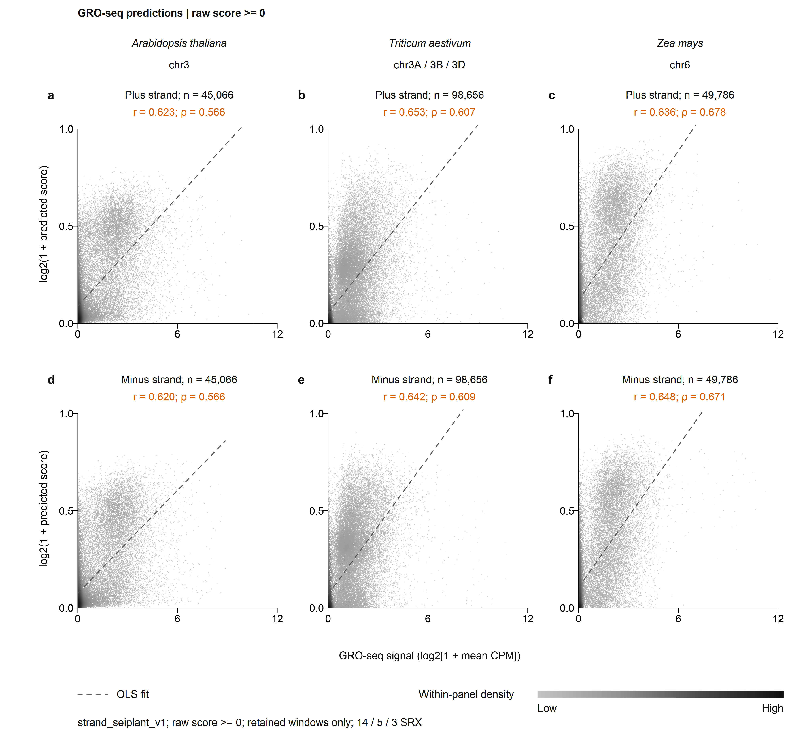
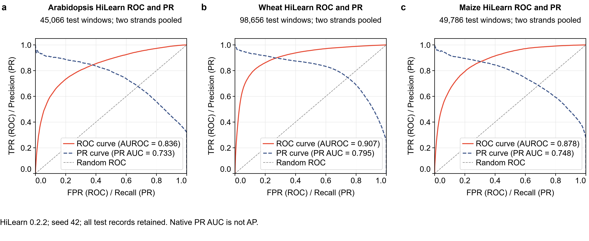
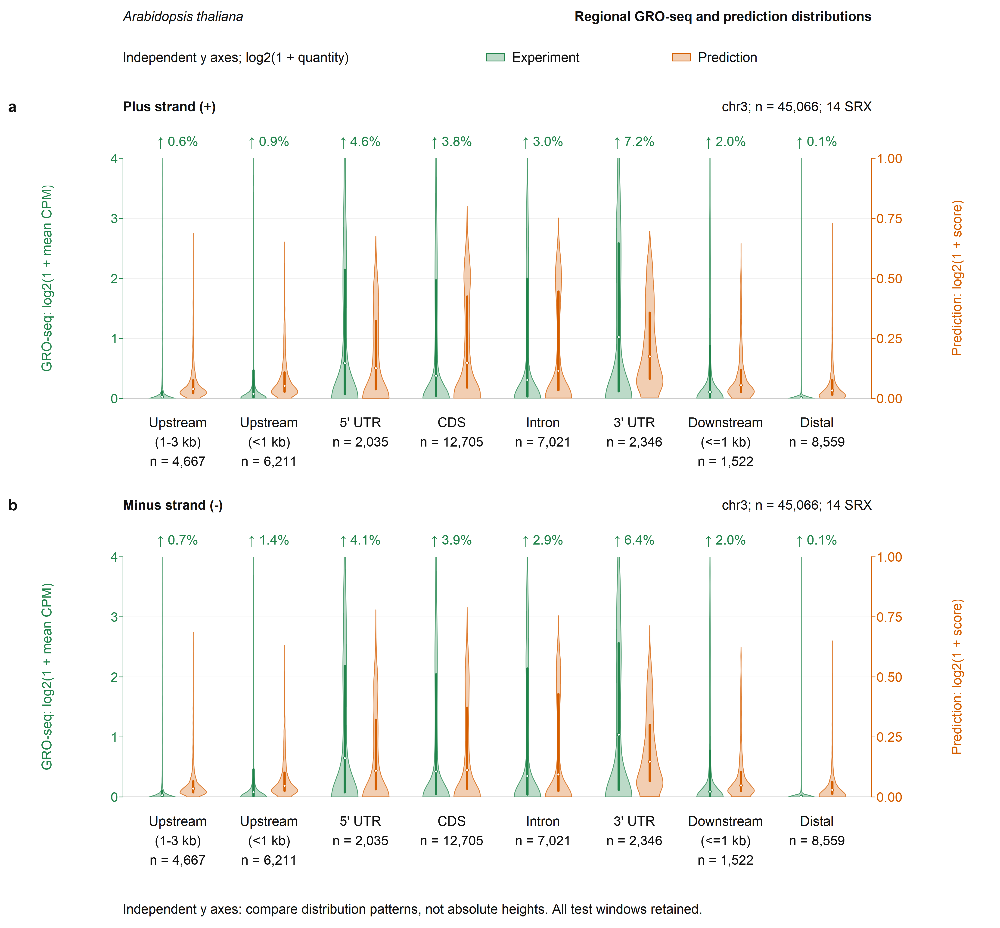
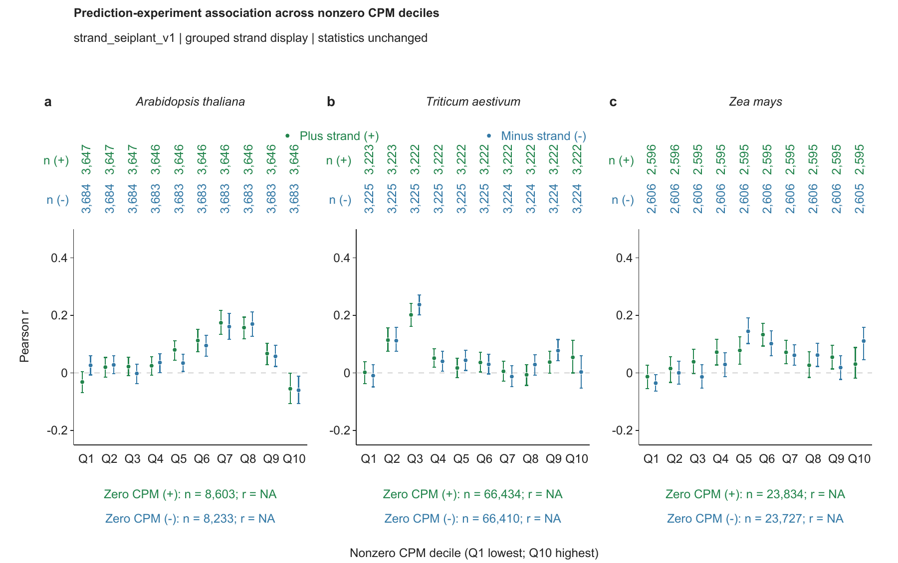
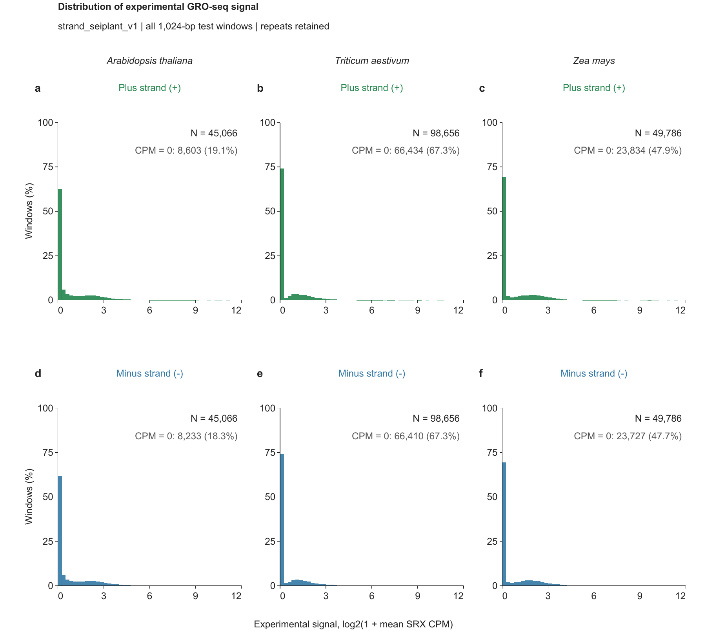
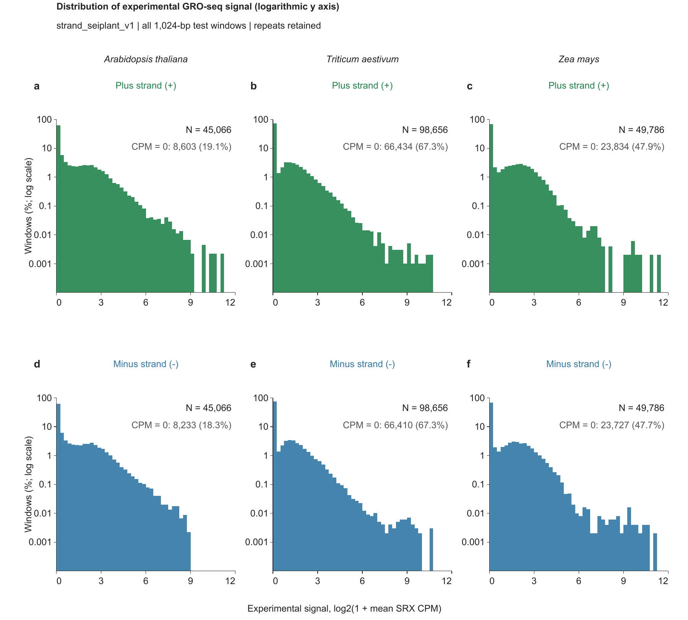

# Current figure previews

All previews use repeat-retained `strand_seiplant_v1`, Arabidopsis / wheat / maize = 14 / 5 / 3 SRX. The full editable figures are regenerated under `figure/results/`.

## Complete-test correlations

## HiLearn native ROC and PR curves

Native PR AUC is not AP. See the figure definitions and the separately stored exact metrics.

## Paired dual-axis violins (Arabidopsis example)

The entry point produces all three species, with both strands. Green reads against the left axis; orange against the independent right axis. Zooming does not discard high-tail observations.

## CPM deciles with grouped strands

The plus/minus strands remain separately ranked and calculated. Points and 95%
intervals use the original frozen statistics; this layout does not pool strands.
See `figure/data/deciles/README.md` for the definitions and draw archives.

## Experimental signal frequencies

All formal test windows, including zeros, contribute to each panel's denominator.
The first bin also contains low positive values; exact zeros are annotated.

This detail view changes only the y-axis display. Counts, percentages and total
window denominators are identical to the linear-percent view.
