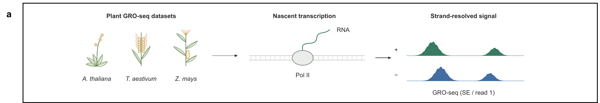
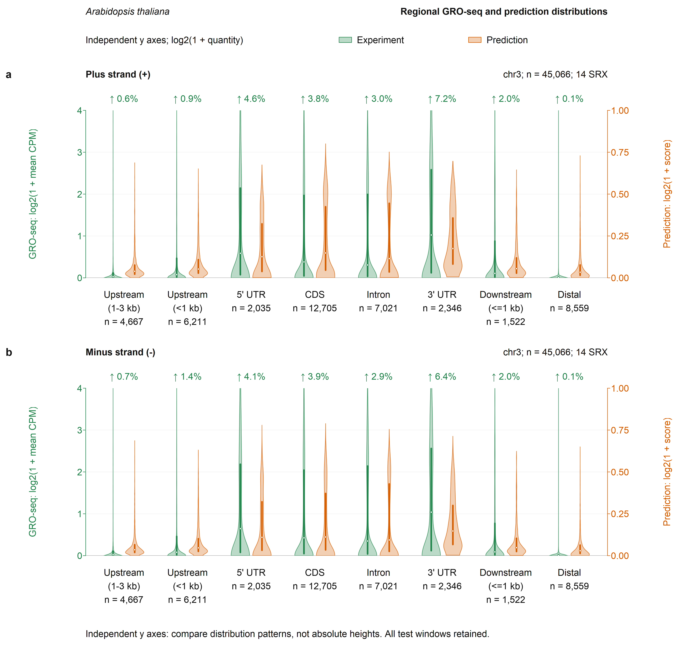
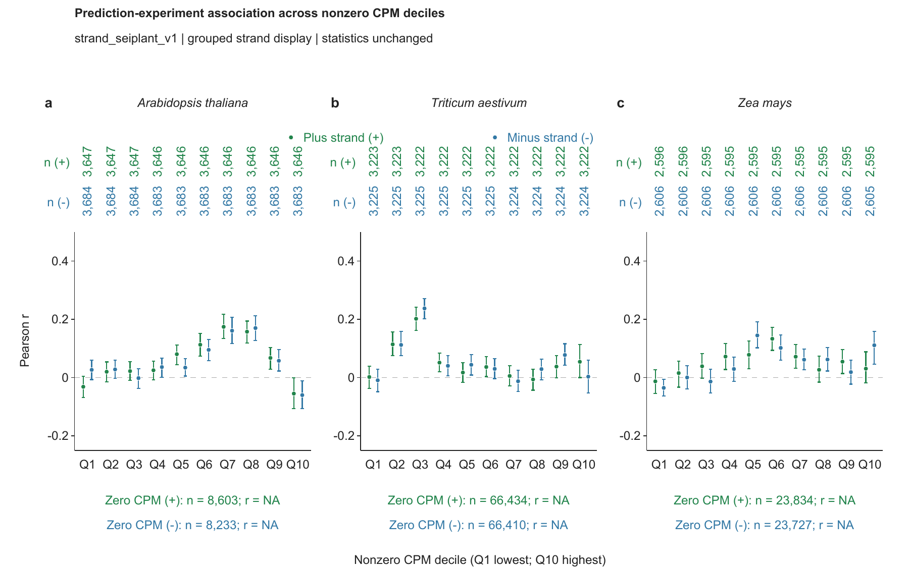
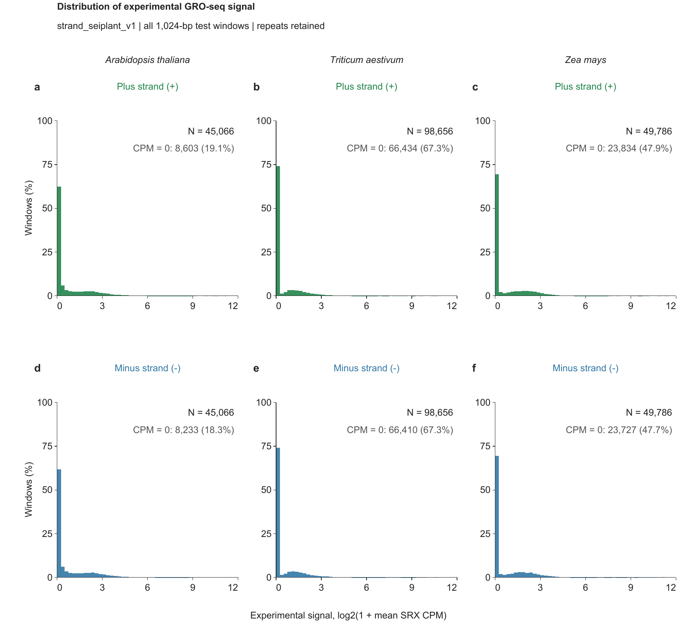
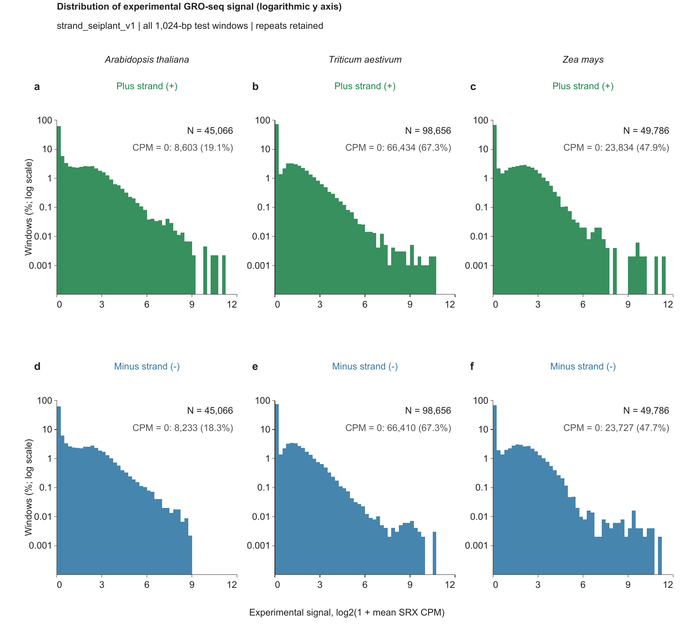

# Current figure previews

## Additional selected final PDFs

- [Workflow, model and evaluation composite](combined_v2/GROseq_combined_v2_A4.pdf) — [code/data guide](../plotting/combined_v2/README.md).
- [CPM decile grouped-strand figure](deciles_final/reference/GROseq_CPM_deciles_grouped_strands_A4.pdf) — [code/data guide](../plotting/deciles_final/README.md).
- [Six-panel regional correlation and mean signal](region_signal_final/region_signal_six_panels_A4.pdf) — [code/data guide](../plotting/region_signal_final/README.md).

These are the unchanged author-selected originals. Regenerated files go to the
local `figure/results/` directory. Individual panel exports are available through
each module's documented entry point.

## GROPlant framework

Panels a and b from the author-supplied `Figure 1. GROseq_combined_v2_A4.pdf`, rendered together at 300 dpi with their original labels and artwork. Panel a illustrates the biological data workflow: Arabidopsis, wheat and maize; nascent transcription by RNA polymerase II; and plus/minus-strand GRO-seq signals from single-end reads or read 1. Panel b shows the complete sequence model: a 1,024-bp one-hot DNA input, convolutional and residual blocks, fixed B-spline pooling and a regression head that produces two raw 0–1 window scores, one per strand.

[Source checksum and extraction details](groplant_framework.source.json) record the original PDF and the exact crop. This preview is extracted from the supplied figure; the plotting commands below do not regenerate it.

## Evaluation previews

### Selected final cross-species radar and genomic tracks

[Original final A4 PDF with caption](radar_tracks/GROseq_radar_tracks_with_legend_A4.pdf) ·
[183 x 210 mm artwork PDF](radar_tracks/GROseq_radar_tracks_artwork_183x210mm.pdf) ·
[Reproduce the full figure or individual panels](../plotting/radar_tracks/README.md) ·
[Exact plotting inputs](../data/radar_tracks/README.md)

Panels a-c combine pooled Pearson r, micro AUROC and P85 micro Jaccard without
normalization. Panels d-f retain the three selected 100-kb genomic examples.
These reference PDFs are the original selected files; rerunning the scripts writes
to `figure/results/radar_tracks/` and does not overwrite these references.

The following results use repeat-retained `strand_seiplant_v1`, Arabidopsis / wheat / maize = 14 / 5 / 3 SRX. The full editable result figures are regenerated under `figure/results/`.

## Complete-test correlations

## HiLearn native ROC and PR curves

Native PR AUC is not AP. See the figure definitions and the separately stored exact metrics.

## Paired dual-axis violins (Arabidopsis example)

The entry point produces all three species, with both strands. Green reads against the left axis; orange against the independent right axis. Zooming does not discard high-tail observations.

## CPM deciles with grouped strands

The plus/minus strands remain separately ranked and calculated. Points and 95%
intervals use the original frozen statistics; this layout does not pool strands.
See `figure/data/deciles/README.md` for the definitions and draw archives.

## Experimental signal frequencies

All formal test windows, including zeros, contribute to each panel's denominator.
The first bin also contains low positive values; exact zeros are annotated.

This detail view changes only the y-axis display. Counts, percentages and total
window denominators are identical to the linear-percent view.
