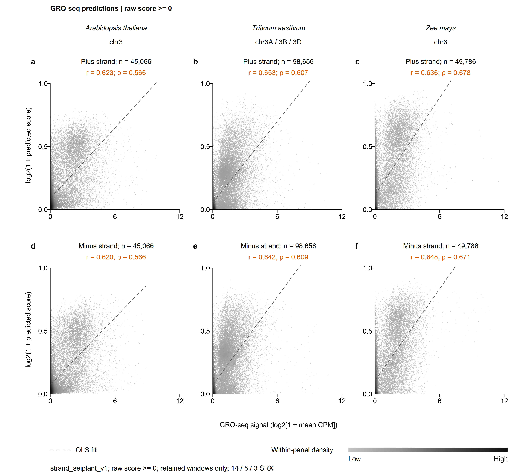
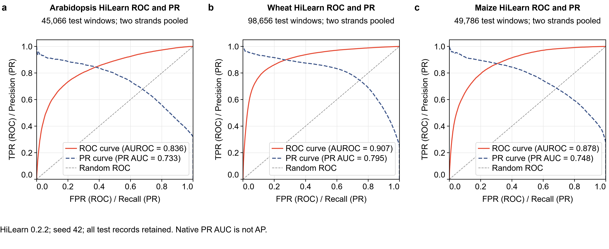
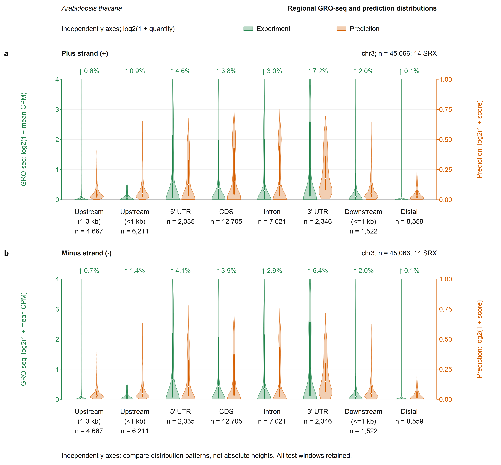

# Current figure previews

All previews use repeat-retained `strand_seiplant_v1`, Arabidopsis / wheat / maize = 14 / 5 / 3 SRX. The full editable figures are regenerated under `publication/generated/`.

## Complete-test correlations

## HiLearn native ROC and PR curves

Native PR AUC is not AP. See the figure definitions and the separately stored exact metrics.

## Paired dual-axis violins (Arabidopsis example)

The entry point produces all three species, with both strands. Green reads against the left axis; orange against the independent right axis. Zooming does not discard high-tail observations.
